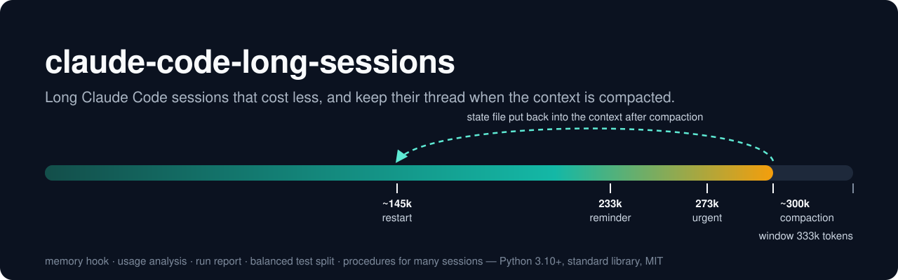
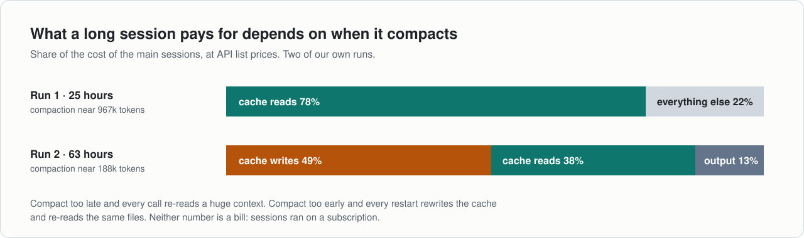
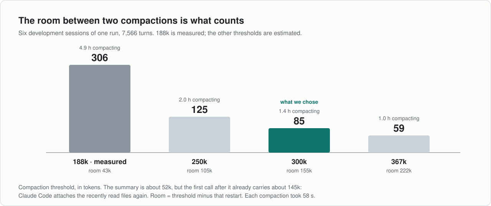
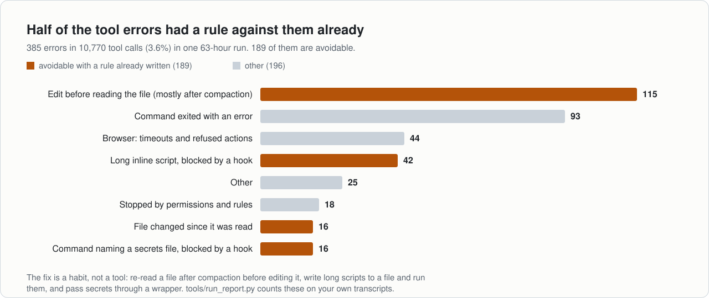
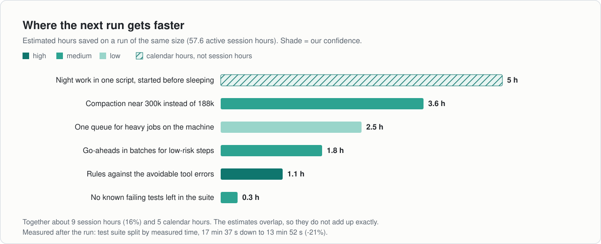

<p align="center"></p>

# claude-code-long-sessions

A small kit for people who run **long Claude Code sessions**, or **several sessions at once**. It keeps
the cost down, keeps a session on track when its context is compacted, and shows you where the hours of
a long run actually went.

Italiano: [README.it.md](README.it.md) · What changed: [CHANGELOG.md](CHANGELOG.md)

| What | File | What it does for you |
|---|---|---|
| Memory hook | `hooks/memory_hook.py` | Each session keeps a short *state file*. The hook reminds the model to update it before compaction and puts it back right after. |
| Usage analysis | `tools/analyze_usage.py` | Where the tokens went, what woke each session up, and what other settings would have cost. |
| Run report | `tools/run_report.py` | Where the *time* went: active hours, compactions and their restart size, tool errors by kind, idle gaps. |
| Test split | `tools/split_tests.py` | Splits a test suite into parts of equal duration, so parallel processes finish together. |
| Procedures | `docs/` | One reviewer over many workers, heavy jobs on one machine, the settings we verified, a 63-hour run measured end to end. |
| Templates | `templates/` | A state file, a "Compact instructions" section and five working rules for your `CLAUDE.md`. |

Python 3.10 or newer, standard library only. Tested on Windows (the hook also understands Git Bash paths
like `/c/Users/...`); written for macOS and Linux too, but not run there yet. This is an independent
project, not affiliated with or endorsed by Anthropic.

## The problem

A long session is expensive for a reason that is easy to miss: **every model call re-reads the whole
context** from the cache. The longer the context, the more each small step costs. When the context is
finally compacted, the summary drops details you needed, such as a decision, a path or a constraint, and
the session spends its next turns finding them again.

So there is no free setting. Compact late and you pay to re-read a huge context on every call. Compact
early and you pay for the restarts: the cache is rewritten, the summary is written, the files are read
again, and some edits fail because the model no longer has the file in view.

## What we measured

Two runs of our own, read from the transcripts with the tools in this kit. Your numbers will differ;
the tools measure yours.

<p align="center"></p>

**Run 1: 25 hours, 5 main sessions, 34 subagents, 10,530 API calls, Claude Code 2.1.302.** Compaction
near 967k.

- **78%** of the cost of the main sessions was re-reading the cached context.
- **1,167** idle re-runs of the `/goal`, about **11%** of the spend. A reviewer waiting for the others
  was re-run **294 times in one hour**.
- Turns started by messages from other sessions: **48%** of the main-session cost. By the person: **8%**.
- Moving the main sessions from Opus to Sonnet was worth only about **11%**: reading the cache costs the same.

**Run 2: 63 hours, 7 sessions, 28 subagents, 9,930 turns, Claude Code 2.1.310.** Compaction near 188k for six of the
sessions. The run shipped 12 software releases, 2 ad campaigns and 9 video clips, with no data incidents.

- **327 compactions** took **5.3 hours**: 58 seconds each, restarting from about 52k tokens.
- **Cache writes** became the largest cost, **49%**, because every restart rewrites the cache.
- The reviewer, compacting near 367k, cost **5% less per turn** than a development session compacting near
  188k: fewer restarts outweighed the longer re-reads.
- **385 tool errors** in 10,770 calls; **189** were avoidable with a rule already written down.
- **624 messages** between sessions, half of them to and from the reviewer.
- No session was awake for **6 hours and 22 minutes** one night, while a release waited for a go-ahead.

<p align="center"></p>

We now compact near **300k** for long working sessions (window 333k) and near 367k for the reviewer
(window 400k). The full story, with every lever we pulled and what each one changed:
[docs/run-63h.md](docs/run-63h.md).

<p align="center"></p>

The lesson of both runs: the big levers are not the model. They are *how long the context gets*, *who
wakes a session up*, *how often a cache expires*, and *what the machine is doing while the sessions wait*.

## Install in 5 minutes

1. **Get the kit** (clone it or copy the folder) and note its absolute path.
2. **Create the state folder** and copy the template there:

   ```
   mkdir ~/.claude/session-state
   cp templates/STATE_TEMPLATE.md ~/.claude/session-state/_TEMPLATE.md
   ```

   (On Windows: `%USERPROFILE%\.claude\session-state`.) Files starting with `_` are never taken for state files.
3. **Add the hooks and the settings.** Merge `hooks/settings.example.json` into `~/.claude/settings.json`.
   Replace `/absolute/path/to/claude-code-long-sessions` with the real path; on Windows write it with
   forward slashes (`C:/Users/me/claude-code-long-sessions`). Use `python` (or `python3`, or `py -3` on
   Windows) in the commands, whichever starts Python 3.10+ on your machine. Check with `/hooks` inside
   Claude Code that the four hooks are listed.
4. **Paste the templates into your `CLAUDE.md`**: `templates/CLAUDE.compact-instructions.md` makes every
   summary start with the path of the state file; `templates/CLAUDE.working-rules.md` holds the five
   habits that removed half of our tool errors.
5. **Check it works.** `python scripts/integration_check.py` runs a small end-to-end test with the Haiku
   model (3 short calls): it writes a state file, adds a secret code from outside, compacts, and asks the
   session for the code. Add `--dry-run` to see the commands first. The unit tests need no network:
   `python -m unittest discover -s tests`.
6. **Measure.** `python tools/analyze_usage.py` for tokens, `python tools/run_report.py` for time.

The `env` block of the example sets three things: `CLAUDE_CODE_AUTO_COMPACT_WINDOW=333000` (compaction
near 300k), `CLAUDE_CODE_STOP_HOOK_BLOCK_CAP=3` (fewer idle `/goal` re-runs in a row) and
`CLAUDE_CODE_SUBAGENT_PROMPT_CACHE_TTL=1h` (a longer cache for subagents). Change them to taste; see
[docs/settings.md](docs/settings.md).

## How the memory hook works

Four commands, one per hook event:

| Command | Event | What it does |
|---|---|---|
| `after-tool` | `PostToolUse` | If the session just wrote a file in the state folder, remembers it as the session's state file. When the context nears compaction, reminds the model to update that file (or to create it). |
| `pre-compact` | `PreCompact` | Records the compaction. Never blocks it. |
| `post-summary` | `PostCompact` | Records whether the summary mentions the state file. |
| `after-compact` | `SessionStart` (matcher `compact`) | Puts the state file back into the context, read from disk, with the instruction to resume from its "Next step". |

The reminders are timed against the window (`CLAUDE_CODE_AUTO_COMPACT_WINDOW`, 1,000,000 if unset):
a first reminder at window minus 100,000 tokens, an urgent one at window minus 60,000, and compaction
itself fires at about window minus 33,000. With a 333k window that is 233k, 273k and about 300k. There
are pauses between reminders, and no reminder if the state file was updated recently. The wording is
deliberately firm ("It's a working rule, not a suggestion").

The state file (`templates/STATE_TEMPLATE.md`) is short, under 8,000 characters, and rewritten rather
than extended: goal and phase, done, decisions, waiting on, next step, files to re-read.

Safety rules of the hook:

- **It never breaks a session.** On any error it prints nothing, exits 0 and adds one entry to
  `errors.log` in the data folder.
- **Subagents are skipped.** They do not keep a state file.
- If the hook missed the moment the session wrote its state file, it looks in the transcript for the last
  state file the session wrote (Write or Edit). A state file the session only read, such as another
  session's, is never taken.

## The tools

### Where the tokens went: `tools/analyze_usage.py`

```
python tools/analyze_usage.py                              # everything under ~/.claude/projects
python tools/analyze_usage.py --since 2026-01-10 --until 2026-01-12 --out report.json
python tools/analyze_usage.py --session <session id> --session <another id>
```

It de-duplicates calls by message id, separates main sessions from subagents, and classifies what
started each turn, weighed on cost. It replays your transcripts with a different compaction threshold
(`--thresholds`), a cap on idle `/goal` re-runs (`--rerun-cap`, default 3) and a 1-hour subagent cache;
the scenario table shows the change on the main sessions and on the total. Costs use the `PRICES` table
at the top of the file: list prices at the time of writing, so check the current ones. The result is a
model of your usage, not a bill.

### Where the time went: `tools/run_report.py`

```
python tools/run_report.py --since 2026-01-10T08:00 --until 2026-01-12T20:00
python tools/run_report.py --session <session id> --session <another id> --out run.json
```

Per session: calendar and active hours (gaps under 5 minutes count as work), turns, seconds per turn,
compactions with the context they fired at and the context they restarted from, minutes spent
compacting, tool errors grouped by kind with the avoidable ones counted apart, messages to other sessions,
and every gap longer than an hour. Subagents are summarised on their own. No conversation text is
printed: only counts and the first line of each error message, with paths and numbers masked.

### Parts of equal duration: `tools/split_tests.py`

```
pytest --junitxml=junit.xml                                # once, to measure
python tools/split_tests.py timings junit.xml --out timings.json
python tools/split_tests.py plan --glob 'tests/test_*.py' --timings timings.json --parts 6
pytest $(python tools/split_tests.py plan --glob 'tests/test_*.py' --timings timings.json --parts 6 --part 3)
```

A suite run in parallel takes as long as its longest part. Splitting by file name gave us parts from 523
to 1,045 seconds; splitting by measured time brought the whole suite from 17 min 37 s to **13 min 52 s
(-21%)** on the same machine. The planner puts the slowest file first into the emptiest part; a file
with no timing weighs the median, and it warns you when too many files have none.

## More than one session, and heavy jobs

- [docs/multi-session.md](docs/multi-session.md): one *reviewer* over several *workers* without paying
  for them to wake each other up. Who holds the `/goal`, what a message must contain, go-aheads in
  batches, how to brief a subagent.
- [docs/heavy-jobs.md](docs/heavy-jobs.md): test suites, renders and builds from several sessions on one
  machine. One queue, a memory cap per job, more processes rather than more threads, the night's work in
  one script, an independent review running next to the tests.
- [docs/run-63h.md](docs/run-63h.md): the 63-hour run, the levers, what we changed and what it gave.

<p align="center"></p>

## Limits

- **Observed on Claude Code 2.1.302 (run 1) and 2.1.310 (run 2).** Some variables are undocumented and may
  change in other versions.
- **The reminder depends on tool calls.** The hook runs after every tool call; a session that answers for
  a long time without using a tool gets no reminder until its next tool call.
- **The hook needs to know your window.** It reads `CLAUDE_CODE_AUTO_COMPACT_WINDOW` and assumes
  1,000,000 when it is not set. If your sessions compact earlier, set the variable, or the reminders come
  too late or never.
- **It asks, it does not force.** The model writes the state file; the hook can only remind it and put the
  file back. A model can still ignore the reminder.
- **Lowering the window below the current context** makes compaction fire at the next call, with no time
  to write the state file.
- **Context cap.** Claude Code truncates the injected context at 10,000 characters; the hook stays under
  9,500 and cuts a longer state file with a pointer to open it.
- **The estimates are models.** The compaction simulation assumes the context grows by the same amount
  per call; the savings per lever in the run report are estimates and overlap. Use them to compare
  settings, not to predict a bill.
- **Our percentages come from two runs.** A different workload gives different shares.

## Tests

```
python -m unittest discover -s tests
```

The tests run the real scripts the way Claude Code and a shell do (JSON on stdin, files on disk) and
read synthetic transcripts and test reports in `tests/fixtures`.

## Credit and license

Built by AAgency from what we learned running long sessions. MIT license, see [LICENSE](LICENSE).
